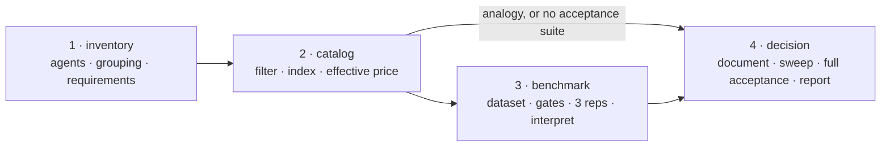

# The process

[README](../../README.md) · [Docs](../index.md)

How a project chooses — and keeps re-choosing — the model behind each of its
LLM agents. This directory is the single source of the process: the `run`
skill reads it, and nothing else restates it. Read this page first; then
only the phase you are in.

Every rule carries its *why* — the general reason it exists — so it can be
applied to cases that don't look like the one that produced it. Paths,
services and variables come from the adapter ([adapter.md](../adapter.md));
the process never names a project's file.

**Goal.** The best experience for each agent: the lowest latency and the
lowest cost that meet its reliability bar — not the highest catalog index
available. *Why:* intelligence an agent doesn't need is paid on every call,
in money and in seconds, and buys the user nothing. This is what makes the
cheaper, faster candidate win a reliability tie.

## Phases

| Phase | Steps | Takes | Leaves |
|---|---|---|---|
| [1 · Inventory](inventory.md) | 1–3 | the code | the agents inventory, the grouping validated, the requirements per variable |
| [2 · Catalog](catalog.md) | 4–6 | the requirements, the live catalog | the candidates table, regenerated, with effective prices |
| [3 · Benchmark](benchmark.md) | 7–14 | finalists, the curated dataset | result rows in the dataset, fixes logged in the protocol log |
| [4 · Decision](decision.md) | 15–17 | results, or a catalog-only decision | decision records, every citing document updated, the run report |

[working-rules.md](working-rules.md) applies to every phase: what an
unattended run does on its own, when it truly stops, and how it handles
secrets.

## Scope of a run

A run starts from the inventory of real agents (step 1), never from the list
of variables that exist today: today's grouping is a hypothesis to re-check
on every run, not a structure to fill with a new model. By default a run
covers every service in the adapter. When the user names a variable, the
benchmark and the decision are limited to it — but the inventory still
covers every service. *Why:* the inventory is the only place a grouping that
has stopped being right shows up, for instance an agent added to a group
without anyone checking that it shares the group's requirements.
